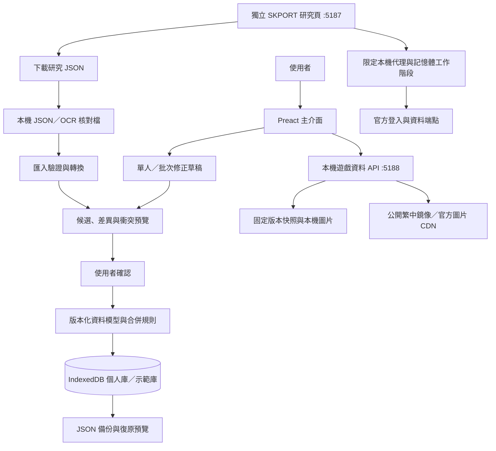

# 幹員檔案室｜明日方舟繁中服工具

以本機保存為主、適合手機瀏覽的幹員資料管理原型。整合研究匯入、繁中圖鑑、技能與模組說明、逐列批次修正，以及備份與復原。

**目前狀態：可在 Windows 本機使用，尚未完成正式產品驗收。** 已完成一份 409 筆幹員研究匯出的讀取與匯入實測；遊戲內逐欄對照、完整持有總數、官方第三方 API 使用授權與 iPhone 真機仍待確認。基建、養成建議與隊伍搭配目前是待實作入口。

本版日期：2026-11-13。技術選擇為 **Preact＋TypeScript＋Vite＋原生 IndexedDB**；目前沒有 Rust／WASM、雲端同步或 Service Worker。

## 功能與進度

| 功能 | 目前行為 | 進度／證據 |
| --- | --- | --- |
| 幹員庫 | 搜尋、職業／星級／精英／資料狀態交集篩選、排序、每頁 48 名、肖像與詳情 | 已實作；[幹員庫驗證](docs/roster-verification.md) |
| 繁中圖鑑 | 幹員、技能各級說明、天賦、模組效果／條件／材料／任務／背景 | 已接入固定來源版本；[資料 API](docs/game-data-api.md)、[模組驗證](docs/module-batch-verification.md) |
| 匯入預覽 | 本工具 v1 JSON、SKPORT v1 研究 JSON；新增／更新／重複／衝突／未知逐項預覽 | 預覽不寫入，確認後保存；[欄位能力表](docs/import-capabilities.md) |
| 逐列批次修正 | 左側選角色，右側直接改欄位；批次填入後逐人微調；養成、技能／專精、模組分類 | 已實作；[批次修正驗證](docs/grid-editor-verification.md) |
| 本機保存 | 示範庫與個人庫隔離；修訂衝突保護、撤銷最後批次 | 已測試交易、重開與撤銷 |
| 備份與復原 | 版本化 JSON、SHA-256 毀損檢查、差異預覽與確認取代 | 已測試往返、拒絕毀損及不相容資料；[資料模型](docs/data-model.md) |
| SKPORT 研究頁 | 官方登入 SDK＋限定本機代理；選定繁中服角色後下載研究 JSON | 已取得 409 筆實測；接口存在、登入成功不等於取得第三方使用授權 |
| 遊戲資料同步 | 手動同步公開鏡像與圖片；幹員、關卡、活動本機 API | 已實作；關卡與活動尚無專用頁面，也沒有定時同步 |
| 多圖辨識核對 | Windows 本機 OCR、來源定位、去重及候選核對 | 六張真圖小樣本；精度、正式 ID 對應與 iPhone 直接辨識尚未完成 |
| 基建／養成建議／搭配 | 僅顯示所需資料與待補項目 | 未實作推薦運算 |
| iPhone／PWA／部署 | 手機尺寸版面已驗證 | 真機、主畫面安裝、完整離線與正式部署未驗收 |

「選用技能」表示紀錄中的技能選擇，例如一技／二技／三技；「裝備模組」是另一個欄位。本工具內修正紀錄不會修改遊戲帳號。沒有模組資料時，介面明確顯示「沒有模組資料」。

## 架構與資料流



| 層次 | 主要程式 | 責任 |
| --- | --- | --- |
| 主介面 | `src/App.tsx`（資料流與保存）、`src/ui/`（版面框架、幹員庫、設定、匯入／預覽／詳情／復原面板、主題）、`BatchEditor.tsx`、`OperatorEncyclopedia.tsx` | 工作區、導航、預覽、保存、逐列草稿及圖鑑；面板內部狀態（衝突決策、搜尋）隨面板開關自動重置 |
| 設計系統 | `src/styles.css` | 顏色、間距與圓角 token；深色預設，淺色跟隨系統或右上角手動切換（只存在這台裝置） |
| 領域層 | `src/domain/` | 資料契約、欄位證據、合併、批次差異與查詢；未知、零、不適用分開 |
| 儲存層 | `src/storage/` | IndexedDB 交易、修訂檢查、備份與復原；舊分頁不能靜默覆蓋新資料 |
| 匯入層 | `src/importers/` | 一般 JSON、SKPORT 封裝及 OCR 候選驗證；以穩定 ID 合併 |
| 公開圖鑑 | `src/catalog/`、`scripts/game-data-sync.ts` | 繁中資料與文字轉換、固定來源下載、完整快照驗證、原子切換及失敗保留上版 |
| 遊戲資料 API | `scripts/game-data-server.ts` | 狀態、幹員、關卡、活動與手動同步 API |
| 獨立研究服務 | `scripts/skport-server.ts`、`skport-proxy.ts`、`skport-client.ts`、`skport-audit.ts` | 限定登入／授權／資料端點、短期工作階段及允許欄位的診斷紀錄 |

研究 JSON 在瀏覽器轉換；查詢圖鑑時不傳送個人 JSON 或養成數值。詳情可以唯讀載入最新本機說明，不直接改個人養成。

目前公開資料驗證基準包含 417 個幹員／轉職形態、3,388 個關卡與 286 筆活動定義；模組包含 481 個進階模組、1,443 個等級與 3,122 筆文字效果。這些是固定版本的圖鑑筆數，**不代表目前開放數量或個人持有數量**。主資料與模組補表分開固定版本，來源詳見 [遊戲資料 API](docs/game-data-api.md)。

## 本機啟動

需要 Node.js 22.22.0 以上及 npm。於專案根目錄執行：

```powershell
npm ci --ignore-scripts --no-audit --no-fund
npm run dev
```

開啟 [本機主介面](http://127.0.0.1:5173/)。首次進入是空的示範工作區，可按「預覽示範批次」確認八名虛構幹員的操作流程。個人資料請在設定切換至個人庫。

使用真實研究 JSON 或圖鑑前，在另一個終端啟動：

```powershell
npm run game-data
```

然後至設定按「更新遊戲資料」。首次同步會連線下載公開資料與圖片；儲存庫不附帶下載快取、肖像或個人研究檔。同步完成後，個人庫可選取 SKPORT 研究 JSON、確認本作繁中服，再檢查候選並確認合併。

| 服務 | 預設位址 | 說明 |
| --- | --- | --- |
| Vite 開發 | `127.0.0.1:5173` | 主介面；代理 `/api/game-data` 到 5188 |
| Vite 建置預覽 | `127.0.0.1:4173` | 服務 `dist/`；同樣代理遊戲資料 API |
| 遊戲資料服務 | `127.0.0.1:5188` | 狀態、幹員、關卡、活動與同步 API |
| SKPORT 研究服務 | `127.0.0.1:5187` | 獨立研究頁、登入代理與 audit log |

所有服務只監聽 loopback。主介面通訊埠被占用時會停止，不會悄悄換網址。停止服務使用 `Ctrl+C`。

### 建置與預覽

```powershell
npm run build
npm run preview
```

`build` 包含 TypeScript 檢查，產物位於 `dist/`。先同步再建置，下載的圖片才會複製進建置產物；預覽使用期間若首次下載或新增圖片，請重新建置。這是開發預覽，不能當正式部署。

**不同 origin 使用不同 IndexedDB。** `5173` 與 `4173`、不同瀏覽器及裝置不會自動共用幹員庫；請使用備份移轉。需要沿用 `5173` 時，先停止同埠開發服務，再執行 `npm run preview -- --port 5173`。

### SKPORT 本機研究頁

```powershell
npm run build
npm run skport
```

開啟 [SKPORT 研究頁](http://127.0.0.1:5187/skport.html)，按「透過本機代理登入」才啟用代理並載入官方 SDK。帳密由官方表單送至限定本機代理後轉送官方；本機服務不將帳密寫入檔案或紀錄。登入後選擇角色、確認本作繁中服，再讀取並下載研究 JSON。

本機後端持有的憑證僅存在服務記憶體，工作階段最多 15 分鐘。「清除本機連線」清除本機工作階段、代理及 SDK 登入 token cache；不能當成官方授權撤銷。不要將此服務改綁外網或公開部署。完整流程與限制見 [代理說明](docs/skport-cors-proxy.md) 及 [audit 記錄](docs/skport-audit-log.md)。

## 修正與保存規則

1. 匯入、單人修正與批次修正都先產生候選；確認前不改已保存幹員。
2. 相同 ID 重複匯入不新增重複角色；局部匯入不刪除未出現幹員，普通缺值不覆蓋既有值。
3. 來源低信心不等於資料錯誤；接受匯入值也不會自動變成人工確認。既有不同值與人工確認值仍需明確處理。
4. 批次頁直接編輯會自動勾選角色；上方「批次填入」可一次改多欄，再逐人微調。預覽列出實際幹員、欄位與新舊值，核對後才保存。
5. 搜尋、翻頁及主頁簽切換保留草稿；取消角色勾選會移除該角色草稿。切換工作區或重新載入不保留草稿。
6. 模組開放、解鎖、等級與裝備分開；單人更正、批次修正與一般匯入共用同一套關聯規則（`src/domain/module-consistency.ts`），預覽列出矛盾，保存時依實際衝突決策再檢查並阻擋矛盾狀態與原始證章升級。未知值不推算為零或未解鎖。
7. 設定頁可撤銷最後批次或下載備份。復原先預覽，確認後會取代該工作區的幹員、設定與歷史。

## 測試與驗收

```powershell
npm test
npm run test:coverage
npm run build
```

最新完整功能驗證為 **198／198 項測試通過**，TypeScript／Vite 建置通過。測試涵蓋格式與合併、IndexedDB 交易與備份、批次修正、公開圖鑑、SKPORT 轉換、代理限制、工作階段清除與 audit 過濾。`fake-indexeddb` 測試不等於 Safari 真機測試。

瀏覽器已驗證示範庫批次不同值保存、重新載入與撤銷，以及個人庫唯讀預覽、取消勾選、草稿跨頁保留和 390×844 版面。個人庫測試沒有保存養成變更。上一輪 Node 覆蓋率為列 99.21%、分支 92.80%，未量測 TSX 瀏覽器覆蓋率。詳細命令與結果見 [逐列批次驗證](docs/grid-editor-verification.md)；本次提交檢查另見 [首版驗證](docs/first-release-verification.md)。

下一步驗收：

完整盤點見 [系統缺口與後續待辦](docs/backlog.md)，包含各模組的優先級、程式依據與完成條件。

- 核對遊戲內持有總數與逐欄語意，優先處理潛能、模組及空值。
- 完成 [iPhone 真機清單](docs/iphone-checklist.md)，包含 Safari／主畫面、儲存、備份移轉及失敗情境。
- 補足官方第三方 API 使用授權與正式登入契約；保持接口、授權、登入和完整性分開查核。
- 依實測改善 OCR 與正式 ID 對應；影片辨識、基建／養成／搭配尚未實作。

## 資料、素材與提交範圍

- 一般幹員庫沒有雲端同步或分析 SDK；資料保存在目前瀏覽器與 origin 的 IndexedDB。
- SHA-256 用於一般毀損檢查，不是來源認證、簽章或加密。
- 一般匯入／研究封裝上限 10 MB、2,000 筆候選；備份上限 20 MB。這不是圖片與影片規格。
- 遊戲資料來自公開鏡像，圖片來自官方 CDN；公開可讀不代表取得再散布授權，資料集授權狀態保留 `unknown`。見 [來源與依賴](docs/licenses.md)。
- `.local/`、`private-fixtures/`、下載的圖片、瀏覽器截圖、備份、環境檔、`node_modules/`、`dist/` 及工具快取均不提交。文件只保留診斷摘要與文字測試證據；私人素材路徑的提及不表示檔案附在儲存庫。
- 請勿在自由文字欄位輸入帳密、Cookie、Token、UID 或電子郵件；格式檢查無法辨識所有秘密字串。
- 沒有 Service Worker 或完整離線資源快取，已開啟頁面的本機操作不等於斷網後可以重開。

## 文件索引

| 文件 | 用途 |
| --- | --- |
| [工作追蹤](docs/tasks.md)／[決策紀錄](docs/decisions.md) | 階段、完成證據與既有決策 |
| [系統缺口與後續待辦](docs/backlog.md) | 全模組現況、P0–P2 優先級、依賴與驗收條件 |
| [P0 公開 API 查核](docs/p0-api-research.md)／[網頁登入補查](docs/p0-web-login-research.md) | 接口、授權與繁中服相容性研究 |
| [SKPORT 登入契約](docs/skport-login-contract.md)／[離線轉換器](docs/skport-offline-adapter.md) | 研究契約與格式 |
| [SKPORT 接入研究](docs/skport-local-prototype.md)／[直接接入基線](docs/skport-live-verification.md) | 歷史實測與失敗邊界 |
| [本機代理](docs/skport-cors-proxy.md)／[audit 記錄](docs/skport-audit-log.md) | 現行研究服務與診斷 |
| [遊戲資料 API](docs/game-data-api.md)／[匯入能力表](docs/import-capabilities.md) | 來源、版本、API 與未驗欄位 |
| [資料模型](docs/data-model.md) | 型別、證據、交易與備份契約 |
| [幹員庫驗證](docs/roster-verification.md)／[模組驗證](docs/module-batch-verification.md)／[批次驗證](docs/grid-editor-verification.md) | 介面與資料操作驗收 |
| [多圖辨識](docs/screenshot-recognition.md)／[第二輪驗證](docs/iteration-2-verification.md) | Windows OCR 命令與小樣本限制 |
| [初輪驗證](docs/verification.md)／[首版驗證](docs/first-release-verification.md) | 歷史與本次提交檢查 |
| [iPhone 清單](docs/iphone-checklist.md)／[來源與依賴](docs/licenses.md) | 待驗項目與權利邊界 |
