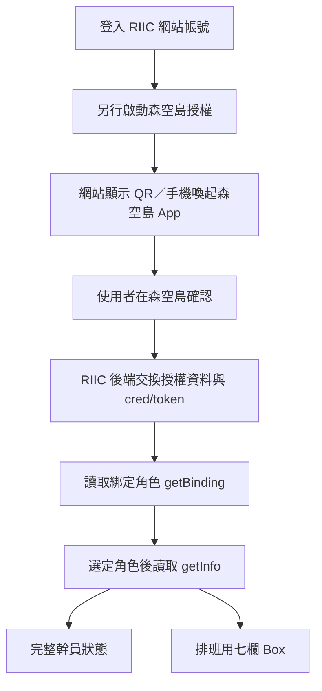

# P0 補查：網頁登入、RIIC 與繁中幹員匯入

查核日期：2026-11-13（Asia/Taipei）。本輪依使用者要求，追查 ArkPR.ts、ArkPRTS、arkprtserver 與 riic.autos 的登入及幹員資料取得實作。

## 結論

**網頁登入後取得幹員資料已有公開實作，但尚未找到這四個候選可直接用於本工具的繁中服登入方案。** RIIC 使用森空島掃碼／憑證及自己的後端；arkprtserver 的現成登入頁使用 Yostar 英／日／韓服。兩套 ArkPR 程式庫雖有繁中類別，這次固定版本的預設繁中登入路徑缺必要設定，且沒有取得初始繁中憑證的完整實作。

本輪取得的是公開原始碼、網站文件與未登入畫面的證據，不是帳號登入成功或完整回應驗收。沒有登入、送出驗證碼、產生掃碼登入工作階段、呼叫私人資料接口、安裝執行候選、傳送照片或啟用本工具同步。

## 版本與比較

| 專案 | 固定版本 | 網頁登入／資料方式 | 繁中判定 |
| --- | --- | --- | --- |
| ArkPR.ts | [7680e683dcc7a650db3cb859f74761a40a8dbfbd](https://github.com/graybearr/ArkPR.ts/commit/7680e683dcc7a650db3cb859f74761a40a8dbfbd) | Node.js 程式庫，可另做網站後端；不是現成登入頁 | `LongchengAuth` 接收既有憑證，但初始取得流程缺失，必要字典沒有 `tw` |
| ArkPRTS | [176ac8a20f4caac72f2c4614e9faff8f9544ed30](https://github.com/ashleney/ArkPRTS/commit/176ac8a20f4caac72f2c4614e9faff8f9544ed30) | Python 程式庫，可由後端呼叫 | 相同的初始憑證缺口與 `tw` 字典缺項 |
| arkprtserver | [ac1f4adf01eecfdb1f335a08e9533708131b1b21](https://github.com/ashleney/arkprtserver/commit/ac1f4adf01eecfdb1f335a08e9533708131b1b21) | 網頁收取 Yostar 電子郵件／驗證碼，後端登入並渲染幹員頁 | 登入頁限英／日／韓；資料 API 接受 `tw` 不等於提供繁中登入 |
| RIIC-Web | [ef67ec34f3312c3e8f9cceb895311048f67008bd](https://github.com/Closure-RIIC/RIIC-Web/commit/ef67ec34f3312c3e8f9cceb895311048f67008bd) | 網站帳號＋森空島授權＋後端讀取 binding/player info | 查到的是森空島實作；沒有 SKPORT 轉接或繁中成功證據 |

三個 P0 候選重新核對的 HEAD 與首輪相同。RIIC 正本由其 [關於頁](https://riic.autos/about) 連結確認為 `Closure-RIIC/RIIC-Web`；上述 commit 日期為 2026-11-06。舊搜尋鏡像仍介紹 Next.js，當前原碼已改為 TanStack 應用與 `platform-server`，未採用鏡像的架構描述。未證明線上部署與此 commit 完全一致。

## RIIC 實際怎麼做

- **網站帳號與遊戲資料授權分開。** 未登入網站時，實際點選「森空島同步」會先顯示網站電子郵件／密碼登入視窗。其[同步文件](https://riic.autos/docs/skland-sync)也明確區分兩個步驟。未輸入任何帳號資料；空白登入介面截圖（本機截圖 `validation/riic-site-login.jpg`，未隨儲存庫提供）只證明入口與欄位存在。
- **網站帳號不是遊戲帳號。** 原碼以 Better Auth、PostgreSQL 維護網站身份；QR route 先要求網站 session，再處理使用者同意及森空島掃碼。[網站認證](https://github.com/Closure-RIIC/RIIC-Web/blob/ef67ec34f3312c3e8f9cceb895311048f67008bd/packages/platform-server/src/auth/index.ts#L18-L69)、[QR route](https://github.com/Closure-RIIC/RIIC-Web/blob/ef67ec34f3312c3e8f9cceb895311048f67008bd/packages/platform-server/src/http/skland/auth/qr/route.ts#L15-L26)。
- **憑證交換及讀取在後端。** `completeScanIdentity()` 換取授權碼與 `cred/token`；`completeOAuthLogin()` 接著讀取綁定、選定角色、取得 player info，最後建立兩種快照。[adapter.ts](https://github.com/Closure-RIIC/RIIC-Web/blob/ef67ec34f3312c3e8f9cceb895311048f67008bd/packages/platform-server/src/skland/adapter.ts#L211-L252)。原碼使用 OAuth 等命名，不足以證明存在可供本專案註冊的官方開發者 OAuth 授權。
- **服務來源是森空島。** RIIC 使用 `skland-kit 0.3.5`；固定上游 commit 為 `bbe0d470d4f00ce1f465c4c7d381000dc3335711`，資料服務預設為 `zonai.skland.com`、帳號服務為 `as.hypergryph.com`。RIIC 的 client 沒有改寫該 baseURL。[core.ts](https://github.com/AEtherside/skland-kit/blob/bbe0d470d4f00ce1f465c4c7d381000dc3335711/src/client/core.ts#L12-L15)、[帳號服務](https://github.com/AEtherside/skland-kit/blob/bbe0d470d4f00ce1f465c4c7d381000dc3335711/src/client/collections/hypergrayph.ts#L36-L40)、[角色與資料讀取](https://github.com/AEtherside/skland-kit/blob/bbe0d470d4f00ce1f465c4c7d381000dc3335711/src/client/collections/player.ts#L41-L56)。

上游 v0.3.5 標籤已核對至上述 commit；本輪未核對 npm 發布 tarball 的位元組一致性。該套件雖可改資料 `baseURL`，授權 host 與森空島 app code 仍另行固定，不能只改一個網址當成 SKPORT 轉接。[設定型別](https://github.com/AEtherside/skland-kit/blob/bbe0d470d4f00ce1f465c4c7d381000dc3335711/src/types/client.ts#L6)、[固定 app code](https://github.com/AEtherside/skland-kit/blob/bbe0d470d4f00ce1f465c4c7d381000dc3335711/src/constants.ts#L6)。

**不能把繁體介面當成繁中服支援。** `rolesFromBinding()` 只挑本作角色並排除空 ID／已刪除角色，沒有明確官服、B服或 TW 白名單。已查路徑沒有 SKPORT adapter 或繁中成功回應，因此結論是「未證實繁中相容」，不是「程式明確禁止台服」。[角色篩選](https://github.com/Closure-RIIC/RIIC-Web/blob/ef67ec34f3312c3e8f9cceb895311048f67008bd/packages/platform-server/src/skland/normalize.ts#L138-L148)。

### 幹員資料有兩種輸出

| RIIC 輸出 | 公開程式實際保留的資料 | 對本工具的意義 |
| --- | --- | --- |
| 完整狀態 `operators` | ID、精英、等級、潛能、信賴、技能等級、各技能專精、模組 ID／名稱／等級／鎖定／預設裝備等 | 是較接近本需求的來源；仍需驗證原始值完整性與未知狀態 |
| 排班 `operbox` | `id/name/elite/level/own/potential/rarity` 七欄 | 沒有專精與模組，不能直接用來驗收完整養成匯入 |

來源：[完整狀態轉換](https://github.com/Closure-RIIC/RIIC-Web/blob/ef67ec34f3312c3e8f9cceb895311048f67008bd/packages/platform-server/src/skland/normalize.ts#L352-L390)、[排班 Box 轉換](https://github.com/Closure-RIIC/RIIC-Web/blob/ef67ec34f3312c3e8f9cceb895311048f67008bd/packages/platform-server/src/skland/normalize.ts#L151-L180)。部分欄位會轉成預設零、技能專精採序號；本工具仍須保留缺值與穩定 ID，不能直接複製其正規化結果。

### 不宜原樣沿用的部分

RIIC 另有人工匯入憑證的備援入口，與本專案不要求人工擷取隱藏憑證的既定邊界不相容。[憑證入口原碼](https://github.com/Closure-RIIC/RIIC-Web/blob/ef67ec34f3312c3e8f9cceb895311048f67008bd/apps/arknights/src/skland-credential-panel.tsx#L93-L141)。

其憑證採加密 Cookie、網站使用者綁定與七天期限；服務端仍會解密使用，並非資料全部留在使用者裝置。[session.ts](https://github.com/Closure-RIIC/RIIC-Web/blob/ef67ec34f3312c3e8f9cceb895311048f67008bd/packages/platform-server/src/skland/session.ts#L6-L75)。

另外，[網站隱私政策](https://riic.autos/privacy)描述完整狀態只留頁面記憶體，但所查 commit 的登入／同步路徑會呼叫 `persistOperatorSnapshot()`，將幹員、UID、暱稱與渠道寫入伺服器 JSON。這是**公開程式與政策描述待核對的差異**；未確認部署版本，不推論線上實際保存行為。[呼叫點](https://github.com/Closure-RIIC/RIIC-Web/blob/ef67ec34f3312c3e8f9cceb895311048f67008bd/packages/platform-server/src/skland/adapter.ts#L249-L252)、[寫檔實作](https://github.com/Closure-RIIC/RIIC-Web/blob/ef67ec34f3312c3e8f9cceb895311048f67008bd/packages/platform-server/src/skland/operator-snapshot-store.ts#L41-L74)。原碼授權為 [PolyForm Noncommercial](https://github.com/Closure-RIIC/RIIC-Web/blob/ef67ec34f3312c3e8f9cceb895311048f67008bd/LICENSE.md)，不等於官方接口使用權。

## 三個 P0 候選的具體缺口

### ArkPR.ts

`LongchengAuth.loginWithToken()` 只接收既有渠道 UID／access token，再呼叫 U8 及遊戲 session 登入；未提供繁中初始憑證取得、官方網頁重導或掃碼實作。[繁中類別](https://github.com/graybearr/ArkPR.ts/blob/7680e683dcc7a650db3cb859f74761a40a8dbfbd/src/auth.ts#L665)。

`CHANNEL_IDS` 與 `NETWORK_VERSIONS` 是本地常數，均缺 `tw`。`getU8Token()` 會在 U8 請求之前，因缺少渠道對照而拋錯。這是固定版本可由程式判定的障礙；沒有執行帳號測試，也不代表補入猜測數字後就會成功。[常數](https://github.com/graybearr/ArkPR.ts/blob/7680e683dcc7a650db3cb859f74761a40a8dbfbd/src/auth.ts#L223-L237)、[缺項檢查](https://github.com/graybearr/ArkPR.ts/blob/7680e683dcc7a650db3cb859f74761a40a8dbfbd/src/auth.ts#L312-L316)。

### ArkPRTS

同樣由 `LongchengAuth.login_with_token()` 消費既有憑證；認證文件記載作者未完成繁中初始 token 取得方式。[說明](https://github.com/ashleney/ArkPRTS/blob/176ac8a20f4caac72f2c4614e9faff8f9544ed30/arkprts/auth.py#L33-L41)、[繁中類別](https://github.com/ashleney/ArkPRTS/blob/176ac8a20f4caac72f2c4614e9faff8f9544ed30/arkprts/auth.py#L651-L667)。

`_get_u8_token()` 與 `_get_secret()` 內部字典均缺 `tw`；預設繁中登入會先遇到第一個字典索引的 `KeyError`。字典在函式內建立，不是遠端可補入的設定。[對照表及呼叫](https://github.com/ashleney/ArkPRTS/blob/176ac8a20f4caac72f2c4614e9faff8f9544ed30/arkprts/auth.py#L293-L338)。兩套另有既有 session 入口，但它們只是消費已取得的秘密，不能解決首次安全登入問題。

### arkprtserver

已實作 `/login → Yostar 認證 → Cookie → /user → authorize() → get_data() → 幹員 HTML`。登入頁與後端僅接受英／日／韓；網頁收到其他服別時改用英文服，而不是轉進繁中登入。這是第三方表單與後端登入協定，不能稱為已提供官方第三方 OAuth。[app.py:391–464](https://github.com/ashleney/arkprtserver/blob/ac1f4adf01eecfdb1f335a08e9533708131b1b21/arkprtserver/app.py#L391-L464)。

`/api/raw/user` 接受 `tw`，但呼叫者必須先有渠道憑證或 session；`/api/user` 則只組裝帳號概況，沒有幹員清單。不要把兩條 API 混為一談。[raw user](https://github.com/ashleney/arkprtserver/blob/ac1f4adf01eecfdb1f335a08e9533708131b1b21/arkprtserver/api.py#L411)、[user](https://github.com/ashleney/arkprtserver/blob/ac1f4adf01eecfdb1f335a08e9533708131b1b21/arkprtserver/api.py#L485)。

此 server 鎖定 `arkprts==0.3.20`；獨立查核的 ArkPRTS HEAD 是 0.3.22，不能把後者直接當成 server 的依賴或線上部署結果。[requirements.txt](https://github.com/ashleney/arkprtserver/blob/ac1f4adf01eecfdb1f335a08e9533708131b1b21/requirements.txt#L2)。其範例將登入參數放入 URL query、將 token 設入 Cookie；不宜原樣搬入本工具。

兩套程式庫的私人幹員讀取均由 `account/syncData` 的 `troop.chars` 建模，而非助戰清單；型別含技能及模組。這證明目標資料路徑，尚未證明繁中回應完整。[TS 資料讀取](https://github.com/graybearr/ArkPR.ts/blob/7680e683dcc7a650db3cb859f74761a40a8dbfbd/src/client.ts#L129)、[Python 資料讀取](https://github.com/ashleney/ArkPRTS/blob/176ac8a20f4caac72f2c4614e9faff8f9544ed30/arkprts/client.py#L144)。

## 對本工具的判斷與下一步

1. **可參考 RIIC 的分工**：畫面發起授權、後端交換及讀取、轉成候選資料，再接本工具既有預覽／合併流程。這是架構參考，不需為研究先更換 Preact 或安裝整套 RIIC。
2. **繁中仍應優先查 SKPORT 本作授權與匯出**：RIIC 的森空島機制不能只改網址就宣稱可用於 SKPORT；三套私人遊戲 API 的現成繁中登入亦不完整。這是本輪證據導出的工程建議。
3. **另開官方頁面登入，不會自動授權我們的網頁讀取資料**：跨網站讀取受同源政策限制，仍需對方支援的授權／匯出契約。加後端能改變請求架構，不能自行補足官方使用權或取得初始憑證。[MDN 同源政策](https://developer.mozilla.org/en-US/docs/Web/Security/Defenses/Same-origin_policy)。
4. **實際帳號測試前仍需符合原計畫 G0–G5**：先取得適用使用方式，再提出只讀、可撤銷、僅選定角色的具體測試範圍。此輪未要求提供秘密，也未新增登入按鈕或後端。

可沿用首輪已備妥的官方詢問稿，具體詢問「本作繁中完整持有庫＋專精／模組、第三方授權／撤銷、玩家結構化匯出」三項。SKPORT 的[隱私政策](https://assets.skport.com/protocols/en/privacy.html)提及資料存取／副本請求，不等於已承諾完整養成 JSON 或即時匯出 API；本輪未聯絡官方。

本輪已收到使用者提供的六張 JPG 幹員畫面，首輪「未取得圖片」敘述只代表首輪狀態；這次沒有進行 OCR、修改／搬移原檔或上傳第三方，亦未將照片視為全庫完整性證明。

## 執行與驗證紀錄

- 實際執行：公開網站／文件讀取、RIIC 未登入介面操作、GitHub 固定 commit 原始碼查核、關鍵呼叫鏈交叉覆核。
- 未執行：任何登入成功測試、QR／OTP 申請、私人接口請求、遊戲寫入、候選安裝／執行、iPhone 真機驗證。
- 本次只新增研究文件與未登入截圖，並補上文件入口；應用程式與套件未變更，因此未重跑與本輪文件無關的建置／測試。
- API 啟用及整體 P0／P1 驗收維持未通過；不將靜態程式分析誤報為實際登入成功。
